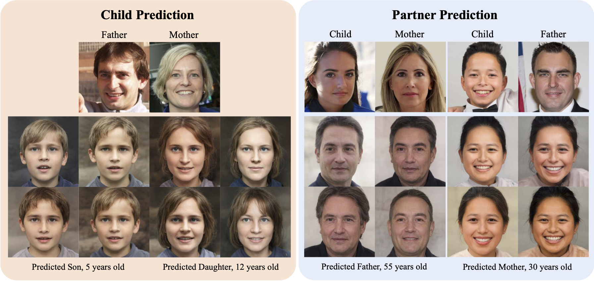

# StyleDiT: A Unified Framework for Diverse Child and Partner Faces Synthesis with Style Latent Diffusion Transformer

**FG 2026**

[Pin-Yen Chiu](https://itsnickchiu.github.io), 
[Dai-Jie Wu](https://jaywu109.github.io/),
[Po-Hsun Chu](),
[Chia-Hsuan Hsu](),
[Hsiang-Chen Chiu](),
[Chih-Yu Wang](https://tom.ky/),
[Jun-Cheng Chen](https://homepage.citi.sinica.edu.tw/pages/pullpull/index_en.html)

Research Center for Information Technology Innovation, Academia Sinica

#### [Project Page](https://styledit.github.io/) | [arXiv](https://arxiv.org/abs/2412.10785)

</img>

## TODO
- [ ] inference code & model weights
- [ ] training code

### Citation
If you find our work useful, please consider cite this work as
```bibtex
@inproceedings{chiu2026styledit,
  title={StyleDiT: A Unified Framework for Diverse Child and Partner Faces Synthesis with Style Latent Diffusion Transformer},
  author={Pin-Yen Chiu and Dai-Jie Wu and Po-Hsun Chu and Chia-Hsuan Hsu and Hsiang-Chen Chiu and Chih-Yu Wang and Jun-Cheng Chen},
  booktitle={IEEE International Conference on Automatic Face and Gesture Recognition (FG)},
  year={2026}
}
```
